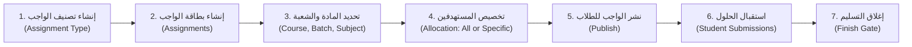
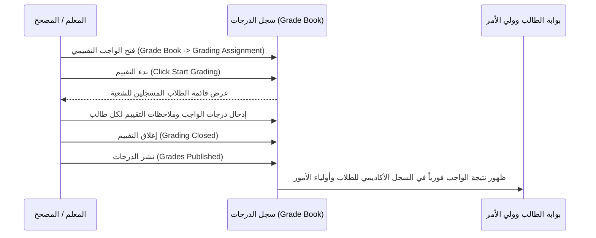

# الدليل الرسمي لمنظومة OpenEduCat 19.0
> **الدليل التعليمي الرسمي: البدء السريع، دورة التهيئة الشاملة، وإدارة وتوزيع الواجبات المدرسية (Allocating Assignments)**  
> *مستخرج ومترجم بالكامل من التوثيق الرسمي لمنظومة OpenEduCat (الإصدار 19.0)*  
> *المرجع الأصلي: [doc.openeducat.org/19.0/getting-started/getting-started.html](https://doc.openeducat.org/19.0/getting-started/getting-started.html#allocating-assignments)*

---

## 📌 الفهرس العام لمراحل التهيئة الرسمية (27 مرحلة)

1. [الحصول على كود المصدر (Getting Source Code)](#1-الحصول-على-كود-المصدر)
2. [إنشاء قاعدة البيانات (Create Database)](#2-إنشاء-قاعدة-البيانات)
3. [إعداد المنشأة والشركة (Setting up Company)](#3-إعداد-المنشأة-والشركة)
4. [التهيئة المحاسبية والمالية (Accounting Setup)](#4-التهيئة-المحاسبية-والمالية)
5. [تثبيت حزم وتطبيقات OpenEduCat (Install OpenEduCat)](#5-تثبيت-تطبيقات-openeducat)
6. [ضبط وتهيئة الموقع الإلكتروني (Configure Website)](#6-ضبط-وتهيئة-الموقع-الإلكتروني)
7. [تفعيل الميزات والخيارات المتقدمة (Configuring in Features)](#7-تفعيل-الميزات-والخيارات-المتقدمة)
8. [إنشاء الأعوام الدراسية (Create Academic Year)](#8-إنشاء-الأعوام-الدراسية)
9. [إنشاء المراحل والصفوف الدراسية (Create Course)](#9-إنشاء-المراحل-والصفوف-الدراسية)
10. [إنشاء المواد الدراسية والمناهج (Create Subject)](#10-إنشاء-المواد-الدراسية-والمناهج)
11. [إنشاء الدفع والشعب الصفية (Create Batch)](#11-إنشاء-الدفع-والشعب-الصفية)
12. [تسجيل الكادر التعليمي والمعلمين (Create Faculty)](#12-تسجيل-الكادر-التعليمي-والمعلمين)
13. [إعداد خادم البريد الصادر (Setting up Outgoing Email)](#13-إعداد-خادم-البريد-الصادر)
14. [ربط المعلم بحساب مستخدم النظام (User of Faculty)](#14-ربط-المعلم-بحساب-مستخدم-النظام)
15. [إنشاء مستخدمي الإدارة والكنترول (Create User For Backoffice Admin)](#15-إنشاء-مستخدمي-الإدارة-والكنترول)
16. [إعداد هياكل وأقساط الرسوم المدرسية (Setting of Fees and Fees Terms)](#16-إعداد-هياكل-وأقساط-الرسوم-المدرسية)
17. [إنشاء سجلات القبول والتسجيل (Create Admission Register)](#17-إنشاء-سجلات-القبول-والتسجيل)
18. [إنشاء وتفعيل حسابات الطلاب (Create Student User)](#18-إنشاء-وتفعيل-حسابات-الطلاب)
19. [إعداد القاعات الدراسية والمعامل (Setup Classroom)](#19-إعداد-القاعات-الدراسية-والمعامل)
20. [إعداد وتوليد الجداول المدرسية (Setting Up TimeTable)](#20-إعداد-وتوليد-الجداول-المدرسية)
21. [⭐ **توزيع وإدارة الواجبات المدرسية (Allocating Assignments)**](#21-توزيع-وإدارة-الواجبات-المدرسية-allocating-assignments)
22. [⭐ **تقييم ورصد درجات الواجبات (Grading Assignments)**](#22-تقييم-ورصد-درجات-الواجبات-grading-assignments)
23. [ملفات أولياء الأمور وبوابة المتابعة (Parent Information)](#23-ملفات-أولياء-الأمور-وبوابة-المتابعة)
24. [تهيئة نظام إدارة التعلم الإلكتروني (LMS Setup)](#24-تهيئة-نظام-إدارة-التعلم-الإلكتروني-lms)
25. [إعداد الاختبارات وبنك الأسئلة (Quiz Setup)](#25-إعداد-الاختبارات-وبنك-الأسئلة)
26. [ضبط إعدادات التعريب والترجمة (Setting of Translation)](#26-ضبط-إعدادات-التعريب-والترجمة)
27. [الفيديو الإرشادي الرسمي لإنشاء مدرسة نموذجية (Official Video Guide)](#27-الفيديو-الإرشادي-الرسمي)

---

## 21. توزيع وإدارة الواجبات المدرسية (Allocating Assignments)

يعد موديول الواجبات المدرسية (`op_assignment`) أحد أهم الأدوات التعليمية لربط المعلم بالطلاب، حيث يتيح للمعلم إسناد الواجبات، تحديد مواعيد التسليم، تحديد عدد المحاولات، واستقبال ملفات الحلول رقمياً.

### أ) خطوات تهيئة أنواع وتصنيفات الواجبات (Assignment Types):
1. انتقل من القائمة الرئيسية إلى: **الواجبات (Assignments) > التهيئة (Configuration) > أنواع الواجبات (Assignment Types)**.
2. انقر على **جديد (New)** وأدخل البيانات:
   * **الاسم (Name):** اسم التصنيف (مثال: واجب منزلي، بحث علمي، تقرير مختبري، نشاط فصلي).
   * **الكود (Code):** رمز تعريفي مختصر (مثال: `HW` للواجبات، `PRJ` للمشاريع).
   * **الشركة / المدرسة (Company):** لتحديد المدرسة التابع لها التصنيف في حال تعدد الفروع.
3. اضغط **حفظ (Save)**.

---

### ب) خطوات إنشاء وتوزيع الواجب على الطلاب (Assignments Form):
انتقل إلى: **الواجبات (Assignments) > الواجبات (Assignments) > انقر جديد (New)**:

| الحقل (Field) | الوصف والاستخدام |
| :--- | :--- |
| **اسم الواجب (Name)** | عنوان الواجب الموجه للطالب (مثال: واجب الرياضيات - حل تمارين التكامل ص 45). |
| **المرحلة الدراسية (Course)** | اختيار الصف الدراسي (مثال: الثالث الثانوي - علمي). |
| **الشعبة (Batch)** | الشعبة المستهدفة (مثال: شعبة أ - بنين). |
| **المادة (Subject)** | المادة التعليمية التابع لها الواجب (مثال: الرياضيات المتقدمة). |
| **المعلم (Faculty)** | المعلم المسؤول عن إعداد الواجب ومتابعته (مثال: أ. وليد الأهدل). |
| **نوع الواجب (Assignment Type)** | التصنيف الذي تم إنشاؤه مسبقاً (واجب منزلي / مشروع). |
| **المراجع / المصحح (Reviewer)** | المعلم أو المشرف المكلف بتصحيح وتدقيق إجابات الطلاب. |

---

### جـ) إعدادات التسليم والمحاولات (Basic Information Tab):
* **تاريخ الإصدار (Issued Date):** موعد بدء ظهور الواجب للطلاب في بواباتهم.
* **تاريخ وموعد التسليم النهائي (Submission Date):** الموعد الأخير لقبول الحلول.
* **عدد المحاولات (Number Of Attempt):**
  * **محاولة واحدة (Single Attempt):** يسمح للطالب برفع ملف الإجابة مرة واحدة فقط ولا يمكنه التعديل بعد الإرسال.
  * **محاولات متعددة (Multiple Attempt):** يتيح للنظام إظهار حقل **الحد الأقصى للمحاولات (Max Attempt)** (مثلاً: 2 أو 3 محاولات لتحسين الدرجة).

---

### د) استهداف الطلاب وتوزيع الواجب (Allocation Information):
* **التوزيع التلقائي على الشعبة كاملة:** إذا تُرِك جدول الطلاب فارغاً، يقوم النظام آلياً بتخصيص الواجب لجميع الطلاب النشطين والمقيدين في الشعبة المحددة.
* **تخصيص الواجب لطلاب محددين (Individual Allocation):** يمكنك النقر على **إضافة سطر (Add a line)** واختيار أسماء طلاب معينين (للواجبات الإثرائية أو خطط الدعم للطلاب المتعثرين).
* **منح محاولات إضافية لطالب محدد (Student Additional Attempt):** في حال رغب المعلم بمنح طالب فرصة إضافية دون فتح المحاولات للجميع، يمكن إضافة اسم الطالب وعدد المحاولات الإضافية الممنوحة له.

---

### هـ) دورة حياة الواجب وبوابة الاعتماد (Workflow & Submission Gate):
1. **مسودة (Draft):** مرحلة الإعداد وصياغة الأسئلة ورفع المرفقات.
2. **نشر (Publish):** بالضغط على زر **نشر (Publish)**، يصبح الواجب مرئياً فوراً في بوابة الطالب (`/my/academic`) وبوابة ولي الأمر.
3. **متابعة غير المسلمين (Missing Submissions Tab):**
   * يظهر النظام تنبيهاً أصفر (**Warning Alert Banner**) يوضح عدد الطلاب الذين لم يسلموا إجاباتهم بعد قبل انتهاء المهلة.
   * عند انتهاء المهلة دون تسليم، يتحول التنبيه إلى أحمر (**Danger Alert Banner**).
4. **إنهاء واعتماد الواجب (Finish & Submission Gate):**
   * يمنع النظام الإغلاق غير المنضبط؛ حيث يشترط زر **إنهاء (Finish)** إما:
     1. تسليم جميع الطلاب المطلوبين لإجاباتهم.
     2. أو مرور وانتهاء الموعد النهائي للتسليم (`Submission Date Passed`).

---

## 22. تقييم ورصد درجات الواجبات (Grading Assignments)

بعد استلام حلول الطلاب عبر البوابة، يتم تقييم الواجب ورصد درجاته من خلال موديول سجل الدرجات الأكاديمي (`Grade Book`):

### خطوات رصد الدرجات عملياً:
1. اذهب إلى: **سجل الدرجات (Grade Book) > تقييم الواجبات (Grading Assignment)**.
2. انقر على **جديد (New)** وحدد:
   * **السنة الدراسية (Academic Year).**
   * **المرحلة والشعبة (Course & Batch).**
   * **المادة (Subject).**
   * **الدرجة العظمى للواجب (Total Marks):** (مثال: 20 درجة).
   * **وزن الواجب في المعدل (Weightage).**
3. انقر على زر **نشر (Publish)** ثم **بدء التقييم (Grading Started)**.
4. انقر على **رصد الدرجات (Start Grading)**:
   * سينقلك النظام إلى جدول كشف درجات الطلاب (`Grade Book Line`).
   * أدخل درجة كل طالب بناءً على الملف الذي رفعه في البوابة.
   * يمكنك كتابة ملاحظات المعلم التوجيهية لكل طالب.
5. انقر على **إغلاق التقييم (Grading Closed)** ثم **نشر النتائج (Grades Published)**.
6. بالضغط على **احتساب المعدل النهائي (Generate Final Grade)**، تنعكس درجات الواجبات تلقائياً في السجل الأكاديمي الموحد وشهادة نصف ونهاية العام.

---

## ملخص المراحل الـ 27 لبناء المدرسة في المنظومة

| # | المرحلة | المسار في النظام | المخرجات الرئيسية |
| :---: | :--- | :--- | :--- |
| **1** | **كود المصدر** | Git Clone / Docker | تثبيت نواة النظام 19.0 والموديولات الـ 14 |
| **2** | **قاعدة البيانات** | Database Manager | إنشاء وتأمين قاعدة بيانات المدرسة (`openeducat`) |
| **3** | **بيانات المنشأة** | الإعدادات > الشركات | اسم المدرسة، الشعار، العنوان، الهاتف، والعملة (`ر.ي`) |
| **4** | **التهيئة المالية** | المحاسبة > التكوين | شجرة الحسابات، فترات الفوترة، ودفاتر اليومية |
| **5** | **تثبيت الموديولات** | التطبيقات (Apps) | تثبيت حزم القبول، الطلاب، الكادر، الجداول، الرسوم |
| **6** | **الموقع الإلكتروني** | الموقع الإلكتروني | تصميم الواجهة الرئيسية، أرقام التواصل، ونموذج التسجيل |
| **7** | **الميزات المتقدمة** | الإعدادات العامة | تفعيل الحضور اليومي، الباركود، والاختبارات |
| **8** | **العام الدراسي** | التهيئة > الأعوام | إنشاء العام الدراسي 2026-2027 والفصلين الأول والثاني |
| **9** | **المراحل الدراسية** | الكورسات (Courses) | تعريف مراحل التعليم الأساسي (1-9) والثانوي (1-3) |
| **10** | **المواد والمناهج** | المواد (Subjects) | إضافة القرآن، الرياضيات، الفيزياء، العربي، وغيرها |
| **11** | **الشعب الصفية** | الشعب (Batches) | تقسيم الطلاب على شعب (أ، ب، ج) وتحديد سعة الصف |
| **12** | **الكادر التعليمي** | المعلمون (Faculties) | إدخال بيانات المعلمين وتخصصاتهم وربطهم بالأقسام |
| **13** | **خادم البريد** | الإعدادات > البريد الصادر | ربط خادم SMTP لإرسال الإشعارات وكلمات المرور آلياً |
| **14** | **حسابات المعلمين** | المستخدمون > الشركاء | منح المعلم حساباً للرصد وتسجيل الحضور بالصلاحيات |
| **15** | **حسابات الإدارة** | المستخدمون والصلاحيات | تعيين مدراء الكنترول، شؤون الطلاب، ومسؤولي التسجيل |
| **16** | **الرسوم والأقساط** | الرسوم (Fees Terms) | تحديد الرسوم السنوية والأقساط وتوليد المطالبات |
| **17** | **سجلات القبول** | القبول والتسجيل | فتح باب التسجيل الإلكتروني واستقبال ملفات المستجدين |
| **18** | **حسابات الطلاب** | الطلاب (Students) | توليد الرقم الأكاديمي (`GR No`) وتفعيل بوابة الطالب |
| **19** | **القاعات والمعامل** | المنشآت (Facilities) | ترقيم القاعات وتحديد الطاقة الاستيعابية لكل فصل |
| **20** | **الجداول المدرسية** | الجداول (Timetables) | جدول الحصص الأسبوعي، منع التعارض، وجداول الحصص |
| **21** | **توزيع الواجبات** | الواجبات (Assignments) | تكليف الطلاب بالواجبات وتحديد المواعيد والمحاولات |
| **22** | **تقييم الواجبات** | سجل الدرجات (Grade Book) | تصحيح الواجبات ورصد الدرجات وإصدار التقارير |
| **23** | **أولياء الأمور** | أولياء الأمور (Parents) | ربط الأبناء بملف الأب وتفعيل تطبيق وبوابة ولي الأمر |
| **24** | **نظام LMS** | التعلم الإلكتروني | رفع الدروس المسجلة، عروض البوربوينت، والمصادر |
| **25** | **بنك الاختبارات** | الاختبارات والامتحانات | بنك الأسئلة، الاختبارات التحريرية، والشهادات بالباركود |
| **26** | **التعريب واللغات** | الترجمة (Translations) | واجهة عربية كاملة RTL ومصطلحات تعليمية دقيقة |
| **27** | **الصيانة والنسخ** | المجلد `scripts/` | أوامر النسخ الاحتياطي الآلي واستعادة البيانات |

---

### 🌐 الروابط والمراجع الرسمية:
* **التوثيق السحابي الأصلي:** [https://doc.openeducat.org/19.0/](https://doc.openeducat.org/19.0/)
* **قسم توزيع الواجبات المباشر:** [Allocating Assignments](https://doc.openeducat.org/19.0/getting-started/getting-started.html#allocating-assignments)
* **دليل التقييم وسجل الدرجات:** [Grading Assignments](https://doc.openeducat.org/19.0/applications/Gradebook/grading-assignment.html)
* **المستودع المحلي للمشروع:** تم حفظ هذا المستند كملف PDF رسمي وملف Markdown داخل مجلد `docs/` بالمشروع.
