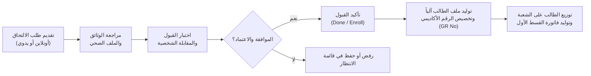
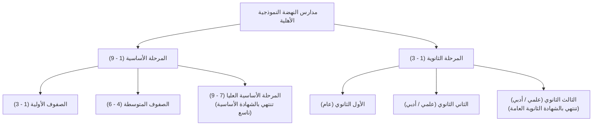
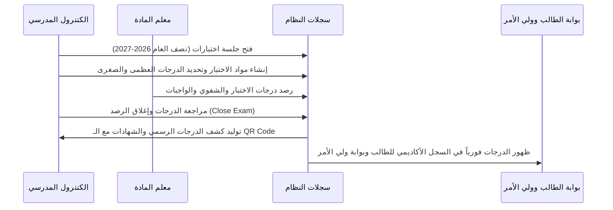

# الدليل التعليمي والإرشادي الشامل لمنظومة سمارت إديو (SmartEdu ERP)
> **نظام إدارة المدارس والمنشآت التعليمية المتكامل — OpenEduCat 19**
> *دليل المستخدم، المشرف الأكاديمي، المعلم، وولي الأمر (مهيأ لبيئة التعليم في الجمهورية اليمنية)*

---

## 📌 فهرس الدليل
1. [نظرة عامة على المنظومة وبيانات الدخول التجريبية](#1-نظرة-عامة-على-المنظومة-وبيانات-الدخول)
2. [دورة حياة القبول والتسجيل (Admission & Enrollment)](#2-دورة-حياة-القبول-والتسجيل)
3. [إدارة شؤون الطلاب والملفات الأكاديمية (Students & SIS)](#3-إدارة-شؤون-الطلاب-والملفات-الأكاديمية)
4. [الكادر التعليمي والإداري وتوزيع المواد (Faculty Management)](#4-الكادر-التعليمي-والإداري-وتوزيع-المواد)
5. [المراحل، الشعب، والقاعات الدراسية (Courses & Classrooms)](#5-المراحل-والشعب-والقاعات-الدراسية)
6. [الجداول المدرسية والحصص الأسبوعية (Timetable & Sessions)](#6-الجداول-المدرسية-والحصص-الأسبوعية)
7. [رصد الحضور والانضباط المدرسي (Attendance & Discipline)](#7-رصد-الحضور-والانضباط-المدرسي)
8. [الكنترول المدرسي وبنك الاختبارات والشهادات (Exams & Marksheets)](#8-الكنترول-المدرسي-وبنك-الاختبارات-والشهادات)
9. [الفواتير والرسوم المدرسية بالريال اليمني (School Fees & Finance)](#9-الفواتير-والرسوم-المدرسية-بالريال-اليمني)
10. [المكتبة المدرسية ونظام الإعارة بالباركود (Library & Media)](#10-المكتبة-المدرسية-ونظام-الإعارة-بالباركود)
11. [الأنشطة والمسابقات الطلابية اللاصفية (Student Activities)](#11-الأنشطة-والمسابقات-الطلابية-اللاصفية)
12. [دليل بوابة ولي الأمر وبوابة الطالب (Self-Service Portals)](#12-دليل-بوابة-ولي-الأمر-وبوابة-الطالب)
13. [الإشراف الفني وإجراءات النسخ الاحتياطي (System Administration & Backup)](#13-الإشراف-الفني-وإجراءات-النسخ-الاحتياطي)

---

## 1. نظرة عامة على المنظومة وبيانات الدخول

منظومة **سمارت إديو (SmartEdu)** هي حل مؤسسي سحابي لإدارة كافة العمليات الأكاديمية، الإدارية، والمالية في المدارس الأهلية والنموذجية. تم تكييف النظام ليتطابق مع السلم التعليمي اليمني:
* **مرحلة التعليم الأساسي (1 - 9):** الصف الأول حتى التاسع (الشهادة الأساسية).
* **مرحلة التعليم الثانوي (1 - 3):** الأول الثانوي العام، والثاني والثالث الثانوي (علمي وأدبي - الشهادة الثانوية العامة).
* **التقويم الدراسي:** فصلان دراسيان (الفصل الدراسي الأول والفصل الدراسي الثاني).
* **العملة الرسمية:** الريال اليمني (`ر.ي` / `YER`).

### روابط المنظومة
* **الرابط السحابي المباشر (Cloud URL):** [https://openeducat.onrender.com](https://openeducat.onrender.com)
* **الرابط المحلي (Local URL):** [http://localhost:8069](http://localhost:8069)

### بيانات الدخول التجريبية الجاهزة للاختبار (Demo Accounts)

| الدور الوظيفي | البريد الإلكتروني (Login) | كلمة المرور | الصلاحيات والمهام |
| :--- | :--- | :--- | :--- |
| **مدير النظام والكنترول** | `admin` | `SmartEduLocal2026!Master` | الصلاحيات الكاملة على كافة الموديولات، الإعدادات، والتقارير |
| **ولي أمر** | `parent@alnahda.edu.ye` | `123456` | متابعة الأبناء، جداول الحصص، الحضور والغياب، وفواتير الرسوم |
| **طالب** | `student@alnahda.edu.ye` | `123456` | استعراض السجل الأكاديمي، كشف درجات الكنترول، وجدول الحصص |

---

## 2. دورة حياة القبول والتسجيل



### خطوات العمل داخل النظام:
1. اذهب إلى: **التسجيل (Admission) > طلبات القبول (Admission Registers)**.
2. انقر على **جديد (New)** لتسجيل طلب طالب جديد:
   * **بيانات الطالب:** الاسم الرباعي، تاريخ ومحل الميلاد، الجنس، والديانة.
   * **المرحلة المستهدفة:** تحديد المرحلة والشعبة (مثال: الثالث الثانوي - علمي).
   * **بيانات ولي الأمر:** ربطه بولي أمر حالي أو إنشاء ولي أمر جديد برقم هاتفه.
3. اضغط **تقديم (Submit)** للانتقال إلى مرحلة المراجعة.
4. بعد مراجعة المستندات اضغط **تأكيد القبول (Enroll)**:
   * يقوم النظام تلقائياً بإنشاء ملف الطالب داخل موديول الطلاب (`op.student`).
   * يتم منح الطالب رقماً أكاديمياً موحداً (مثل: `YEM-2026-101`).

---

## 3. إدارة شؤون الطلاب والملفات الأكاديمية

موديول الطلاب هو النواة المركزية التي تتجمع فيها كافة العمليات (الدرجات، الحضور، الرسوم، والأنشطة).

### الوصول لملف الطالب:
* القائمة الرئيسية > **الطلاب (Students) > الطلاب (Students)**.

### محتويات بطاقة الطالب:
* **البيانات الشخصية:** الاسم باللغتين العربية والإنجليزية، الرقم الأكاديمي (`GR Number`)، الصورة الشخصية، وتاريخ الميلاد.
* **الارتباط بولي الأمر:** ربط الطالب بملف ولي الأمر مع تحديد صلة القرابة (أب، أم، وصي).
* **السجل الصحي:** فصيلة الدم، الحساسية، والأمراض المزمنة في حال وجودها.
* **الأزرار الذكية (Smart Buttons) أعلى الملف:**
  * عدد أيام الحضور والغياب.
  * فواتير الرسوم المدرسية المسددة والمتبقية.
  * كشوفات درجات الكنترول والاختبارات.
  * بطاقة المكتبة المدرسية والإعارات الحالية.

---

## 4. الكادر التعليمي والإداري وتوزيع المواد

* القائمة الرئيسية > **المعلمون (Faculties) > المعلمون (Faculties)**.

### مهام إدارة المعلمين:
1. **تسجيل المعلم الجديد:**
   * إدخال البيانات الشخصية، المؤهل العلمي، والدرجة التخصصية.
   * تعيين القسم الرئيسي (مثال: قسم العلوم الطبيعية والرياضيات).
2. **ربط المعلم بالمواد (Subjects):**
   * في تبويب **المواد الدراسية (Subjects)**: تحديد المواد التي يحق للمعلم تدريسها (مثال: د. عبدالله باوزير -> مادة الفيزياء).
3. **تحديد النصاب والجدول:**
   * ربط المعلم بالشعب الدراسية والقاعات لتفادي أي تضارب زمني أثناء إعداد الجدول المدرسي.

---

## 5. المراحل، الشعب، والقاعات الدراسية

تم ضبط النظام وفق هيكل التعليم اليمني النموذجي:



### إدارة القاعات والمعامل (Classrooms & Labs):
* اذهب إلى: **المنشآت والقاعات (Facilities / Classrooms)**.
* تم إعداد قاعات متخصصة مثل:
  * **قاعة الخوارزمي:** مخصصة لطلاب الثالث الثانوي علمي.
  * **معمل القدس:** معمل الحاسوب والبرمجة والذكاء الاصطناعي.
  * **معمل ابن سينا:** معمل الكيمياء والتجارب العملية.
  * **قاعة المتنبي:** الصف التاسع الأساسي.
  * **قاعة بلقيس:** الصف الأول الأساسي.
* كل قاعة محدد لها **الطاقة الاستيعابية القصوى (Capacity)** لضمان عدم تجاوز كثافة الطلاب الموصى بها في الفصول.

---

## 6. الجداول المدرسية والحصص الأسبوعية

* القائمة الرئيسية > **الجدول المدرسي (Timetable) > الحصص والجلسات (Sessions)**.

### خطوات جدولة الحصص المدرسية:
1. **الجدولة اليدوية للحصة:**
   * اختر الشعبة (مثال: `الثالث الثانوي - علمي`).
   * اختر المادة الدراسية (مثال: `الرياضيات المتقدمة`).
   * اختر المعلم (مثال: `أ. وليد الأهدل`).
   * اختر القاعة الدراسية (مثال: `قاعة الخوارزمي`).
   * حدد وقت البداية والنهاية (مثال: الأحد من الساعة 08:00 إلى 08:45 صباحاً).
2. **منع التعارض الذكي:**
   * يمنع النظام تلقائياً حجز نفس المعلم أو نفس القاعة في نفس الوقت لحصتين مختلفتين، ويعرض تحذيراً فورياً للمشرف الأكاديمي.
3. **استعراض الجدول:**
   * يمكن عرض الجدول كتقويم أسبوعي ملون (Calendar View)، أو جدول منظم حسب القاعات أو المعلمين.

---

## 7. رصد الحضور والانضباط المدرسي

* القائمة الرئيسية > **الحضور (Attendance) > دفاتر الحضور (Attendance Registers)**.

### دورة الرصد اليومي:
1. يفتح المشرف أو المعلم دفتر حضور الشعبة (مثال: `كشف حضور - الثالث الثانوي علمي`).
2. يضغط على **إنشاء ورقة حضور يومية (New Sheet)**.
3. يحدد تاريخ اليوم، ليقوم النظام تلقائياً بجلب قائمة أسماء كافة الطلاب المسجلين بالشعبة.
4. الخيارات المتاحة أمام كل طالب:
   * **حاضر (Present):** وهو الخيار الافتراضي لسرعة الإنجاز.
   * **غائب (Absent):** في حال عدم الحضور.
   * **متأخر (Late):** مع إمكانية كتابة مدة التأخر وسببه في الملاحظات.
   * **معذور (Excused):** في حال تقديم عذر طبي أو موافقة مسبقة من الإدارة.
5. الضغط على **اعتماد (Done)** لحفظ الكشف وإرسال السجلات لبوابة ولي الأمر وإحصائيات الغياب العامة.

---

## 8. الكنترول المدرسي وبنك الاختبارات والشهادات

يدعم النظام دورة عمل الكنترول المدرسي المتوافقة مع معايير وزارة التربية والتعليم:



### مميزات كشف الدرجات والشهادة الرسمية في المنظومة:
* **الدرجات العظمى والصغرى:** الدرجة من 100 مع حد النجاح الأدنى 50.
* **حساب النسبة والتقدير العام:** (ممتاز 90%+، جيد جداً 80%+، جيد 65%+، مقبول 50%+، راسب دون 50%).
* **رمز التحقق المشفر (QR Code):** تحتوي كل شهادة أو كشف درجات مطبوع على باركود QR ذكي يمكن قراءته بأي هاتف ذكي للتحقق من صحة الوثيقة ومنع التزوير.

---

## 9. الفواتير والرسوم المدرسية بالريال اليمني

* القائمة الرئيسية > **الفواتير والرسوم (Invoicing / Fees)**.

### إدارة الأقساط والرسوم:
1. **هياكل الرسوم (Fee Structures):**
   * تحديد قيمة الرسوم الدراسية للمرحلة (مثال: `350,000 ر.ي` سنوياً).
   * إمكانية تقسيم الرسوم إلى قسطين أو 4 أقساط فصلية.
2. **إصدار المطالبات والفواتير:**
   * يتم إصدار الفاتورة باسم ولي الأمر مع تحديد اسم الطالب والشعبة.
   * تظهر الفاتورة بالعملة الوطنية: **الريال اليمني (`ر.ي`)**.
3. **السداد والتحصيل:**
   * تسجيل سندات القبض عند استلام المبالغ (نقداً، شيك، أو حوالة بنكية).
   * تنعكس الدفعات والمبالغ المتبقية تلقائياً في بوابة ولي الأمر (`/my/invoices`).

---

## 10. المكتبة المدرسية ونظام الإعارة بالباركود

* القائمة الرئيسية > **المكتبة (Library) > الوسائط والكتب (Media)**.

### آليات إدارة المكتبة:
* **فهرسة الكتب والمراجع:** تصنيف الكتب بحسب الموضوع (تاريخ وأنساب اليمن، فيزياء، لغة عربية، حاسوب وبرمجة).
* **إدارة المؤلفين ودور النشر:** مثل كتب الهمداني وابن سينا.
* **تتبع النسخ بالباركود (Media Units):** لكل نسخة مادية من الكتاب باركود فريد يطبع ويوضع على غلاف الكتاب.
* **عمليات الإعارة والاسترجاع (Issue & Return):**
  * مسح باركود بطاقة الطالب.
  * مسح باركود الكتاب.
  * تحديد تاريخ الاسترجاع المتوقع وتتبع الكتب المتأخرة آلياً.

---

## 11. الأنشطة والمسابقات الطلابية اللاصفية

* القائمة الرئيسية > **الأنشطة المدرسية (Student Activities)**.

### التوثيق الأكاديمي للأنشطة:
* توثيق مشاركات الطلاب في المسابقات القرآنية السنوية، دوريات كرة القدم، المعارض العلمية، ومسابقات الخط العربي.
* رصد جوائز ومراكز الطلاب (مثل: حصول الطالب على المركز الأول في حفظ 15 جزءاً برواية حفص).
* إدراج سجل الأنشطة والتميز السلوكي ضمن شهادة التخرج والسجل التراكمي للطالب.

---

## 12. دليل بوابة ولي الأمر وبوابة الطالب

بوابات الخدمة الذاتية تتيح التواصل المباشر مع الأسرة والطلاب على مدار 24 ساعة عبر أي متصفح أو هاتف ذكي:

### 1. بوابة ولي الأمر (`https://openeducat.onrender.com/my/child`):
* تسجيل الدخول: `parent@alnahda.edu.ye` / `123456`.
* **لوحة متابعة الأبناء:** استعراض بطاقات الأبناء المسجلين في المدرسة بنقرة واحدة (أسامة، مريم، إلخ).
* **كشف الحضور والغياب:** الاطلاع الفوري على حالات التأخير أو الغياب وتواريخها.
* **النتائج والتقارير:** استعراض الدرجات الفصلية وشهادات التقدير فور اعتمادها من الكنترول.
* **الفواتير المدرسية (`/my/invoices`):** كشف حساب مالي يوضح الأقساط المعتمدة والمدفوعات والمتبقي بالريال اليمني.

### 2. بوابة السجل الأكاديمي للطالب (`https://openeducat.onrender.com/my/academic`):
* تسجيل الدخول: `student@alnahda.edu.ye` / `123456`.
* **الرقم الأكاديمي:** بطاقة تعريفية بالرقم الموحد (`YEM-2026-101`) والشعبة المسجل بها.
* **جدول الحصص الأسبوعي:** استعراض الحصص اليومية، القاعات، وأسماء المعلمين.
* **المقررات والنتائج:** درجات الاختبارات النصفية والنهائية فور إعلانها.

---

## 13. الإشراف الفني وإجراءات النسخ الاحتياطي

### سكربتات الصيانة والنسخ الاحتياطي (الموجودة في المجلد `scripts/`):

1. **أخذ نسخة احتياطية كاملة (Backup):**
   ```bash
   bash scripts/backup.sh
   ```
   يقوم بإنشاء ملف مضغوط يجمع قاعدة البيانات كاملة والمرفقات والصور (`filestore`) مع تاريخ ووقت العملية.

2. **استعادة النظام (Restore):**
   ```bash
   bash scripts/restore.sh /path/to/backup_file.tar.gz
   ```

3. **إعادة توليد البيانات التجريبية الشاملة:**
   ```bash
   python3 scripts/create_yemen_demo_data.py
   ```

---

> [!TIP]
> **نصيحة للإداريين الجدد:**
> ينصح دائماً بالبدء بإنشاء **العام الدراسي والفصلين**، ثم **القاعات**، ثم **المواد والمعلمين**، وأخيراً **الشعب الدراسية** قبل البدء في تسجيل الطلاب لتسهيل ربط البيانات بسلاسة.
